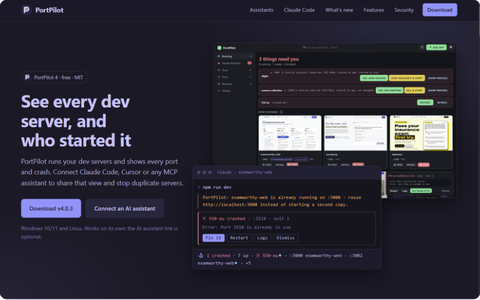
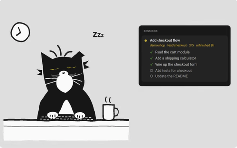
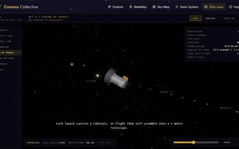
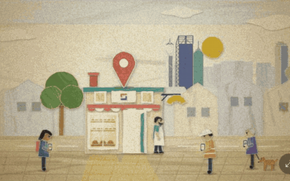
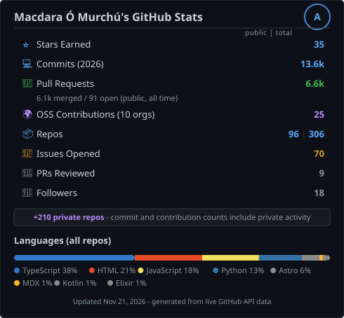

## Hi, I'm Macdara

I'm a developer in Perth. I build web apps in TypeScript, React and Node, and I look after them after they launch.

---

### Tech

---

### Open Source Contributions

**Merged**

**Under review**

---

### Featured Projects

<table>
<tr>
<td width="200"></td>
<td><a href="https://azureprep.com"><b>AzurePrep</b></a> Microsoft exam practice</td>
</tr>
<tr>
<td width="200"></td>
<td><a href="https://stationstreetfit.com.au"><b>Station Street Fitness</b></a> Client site in Next.js, replacing WordPress</td>
</tr>
<tr>
<td width="200"></td>
<td><a href="https://m4cd4r4.github.io/PortPilot/"><b>PortPilot</b></a> Shows every dev server and who started it</td>
</tr>
<tr>
<td width="200"></td>
<td><a href="https://github.com/m4cd4r4/cornerman"><b>Cornerman</b></a> Carries long Claude Code chats into fresh ones</td>
</tr>
<tr>
<td width="200"></td>
<td><a href="https://github.com/m4cd4r4/questlog"><b>Questlog</b></a> Shows what each Claude Code session is doing</td>
</tr>
<tr>
<td width="200"></td>
<td><a href="https://cosmos-collective.com.au"><b>Cosmos Collective</b></a> Explore real NASA and ESA space data</td>
</tr>
<tr>
<td width="200"></td>
<td><a href="https://examworthy.com"><b>ExamWorthy</b></a> Certification exam prep across vendors</td>
</tr>
<tr>
<td width="200"></td>
<td><a href="https://statewiseexams.com"><b>Statewise</b></a> US insurance licensing exam prep</td>
</tr>
<tr>
<td width="200"></td>
<td><a href="https://solaisoft.com"><b>Solaisoft</b></a> My web studio for Perth businesses</td>
</tr>
</table>

---

### Stats

---

### Activity

<picture>
  <source media="(prefers-color-scheme: dark)" srcset="https://github.com/m4cd4r4/m4cd4r4/blob/output/github-snake-dark.svg" />
  <source media="(prefers-color-scheme: light)" srcset="https://github.com/m4cd4r4/m4cd4r4/blob/output/github-snake.svg" />
  
</picture>
