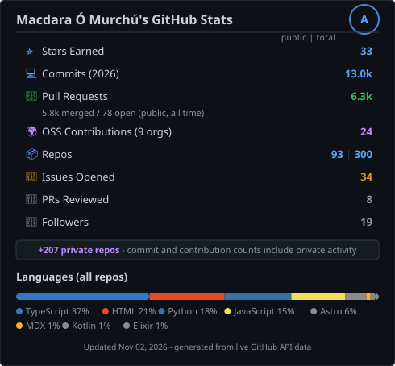

## Hi, I'm Macdara

I'm a developer in Perth. I build web apps in TypeScript, React and Node, and I look after them after they launch.

---

### Tech

---

### Open Source Contributions

**Merged**

**Under review**

---

### Featured Projects

<a href="https://azureprep.com"><picture><source media="(max-width: 380px) and (prefers-color-scheme: dark)" srcset="https://raw.githubusercontent.com/m4cd4r4/m4cd4r4/refs/heads/test/responsive-cards/assets/cards/azureprep-m-dark.gif 2.24x"><source media="(max-width: 380px)" srcset="https://raw.githubusercontent.com/m4cd4r4/m4cd4r4/refs/heads/test/responsive-cards/assets/cards/azureprep-m-light.gif 2.24x"><source media="(max-width: 800px) and (prefers-color-scheme: dark)" srcset="https://raw.githubusercontent.com/m4cd4r4/m4cd4r4/refs/heads/test/responsive-cards/assets/cards/azureprep-m-dark.gif 2x"><source media="(max-width: 800px)" srcset="https://raw.githubusercontent.com/m4cd4r4/m4cd4r4/refs/heads/test/responsive-cards/assets/cards/azureprep-m-light.gif 2x"><source media="(prefers-color-scheme: dark)" srcset="https://raw.githubusercontent.com/m4cd4r4/m4cd4r4/refs/heads/test/responsive-cards/assets/cards/azureprep-d-dark.gif 2x"><source srcset="https://raw.githubusercontent.com/m4cd4r4/m4cd4r4/refs/heads/test/responsive-cards/assets/cards/azureprep-d-light.gif 2x"></picture></a>
<a href="https://stationstreetfit.com.au"><picture><source media="(max-width: 380px) and (prefers-color-scheme: dark)" srcset="https://raw.githubusercontent.com/m4cd4r4/m4cd4r4/refs/heads/test/responsive-cards/assets/cards/ssf-m-dark.png 2.24x"><source media="(max-width: 380px)" srcset="https://raw.githubusercontent.com/m4cd4r4/m4cd4r4/refs/heads/test/responsive-cards/assets/cards/ssf-m-light.png 2.24x"><source media="(max-width: 800px) and (prefers-color-scheme: dark)" srcset="https://raw.githubusercontent.com/m4cd4r4/m4cd4r4/refs/heads/test/responsive-cards/assets/cards/ssf-m-dark.png 2x"><source media="(max-width: 800px)" srcset="https://raw.githubusercontent.com/m4cd4r4/m4cd4r4/refs/heads/test/responsive-cards/assets/cards/ssf-m-light.png 2x"><source media="(prefers-color-scheme: dark)" srcset="https://raw.githubusercontent.com/m4cd4r4/m4cd4r4/refs/heads/test/responsive-cards/assets/cards/ssf-d-dark.png 2x"><source srcset="https://raw.githubusercontent.com/m4cd4r4/m4cd4r4/refs/heads/test/responsive-cards/assets/cards/ssf-d-light.png 2x"></picture></a>
<a href="https://m4cd4r4.github.io/PortPilot/"><picture><source media="(max-width: 380px) and (prefers-color-scheme: dark)" srcset="https://raw.githubusercontent.com/m4cd4r4/m4cd4r4/refs/heads/test/responsive-cards/assets/cards/portpilot-m-dark.png 2.24x"><source media="(max-width: 380px)" srcset="https://raw.githubusercontent.com/m4cd4r4/m4cd4r4/refs/heads/test/responsive-cards/assets/cards/portpilot-m-light.png 2.24x"><source media="(max-width: 800px) and (prefers-color-scheme: dark)" srcset="https://raw.githubusercontent.com/m4cd4r4/m4cd4r4/refs/heads/test/responsive-cards/assets/cards/portpilot-m-dark.png 2x"><source media="(max-width: 800px)" srcset="https://raw.githubusercontent.com/m4cd4r4/m4cd4r4/refs/heads/test/responsive-cards/assets/cards/portpilot-m-light.png 2x"><source media="(prefers-color-scheme: dark)" srcset="https://raw.githubusercontent.com/m4cd4r4/m4cd4r4/refs/heads/test/responsive-cards/assets/cards/portpilot-d-dark.png 2x"><source srcset="https://raw.githubusercontent.com/m4cd4r4/m4cd4r4/refs/heads/test/responsive-cards/assets/cards/portpilot-d-light.png 2x"></picture></a>
<a href="https://github.com/m4cd4r4/cornerman"><picture><source media="(max-width: 380px) and (prefers-color-scheme: dark)" srcset="https://raw.githubusercontent.com/m4cd4r4/m4cd4r4/refs/heads/test/responsive-cards/assets/cards/cornerman-m-dark.png 2.24x"><source media="(max-width: 380px)" srcset="https://raw.githubusercontent.com/m4cd4r4/m4cd4r4/refs/heads/test/responsive-cards/assets/cards/cornerman-m-light.png 2.24x"><source media="(max-width: 800px) and (prefers-color-scheme: dark)" srcset="https://raw.githubusercontent.com/m4cd4r4/m4cd4r4/refs/heads/test/responsive-cards/assets/cards/cornerman-m-dark.png 2x"><source media="(max-width: 800px)" srcset="https://raw.githubusercontent.com/m4cd4r4/m4cd4r4/refs/heads/test/responsive-cards/assets/cards/cornerman-m-light.png 2x"><source media="(prefers-color-scheme: dark)" srcset="https://raw.githubusercontent.com/m4cd4r4/m4cd4r4/refs/heads/test/responsive-cards/assets/cards/cornerman-d-dark.png 2x"><source srcset="https://raw.githubusercontent.com/m4cd4r4/m4cd4r4/refs/heads/test/responsive-cards/assets/cards/cornerman-d-light.png 2x"></picture></a>
<a href="https://github.com/m4cd4r4/questlog"><picture><source media="(max-width: 380px) and (prefers-color-scheme: dark)" srcset="https://raw.githubusercontent.com/m4cd4r4/m4cd4r4/refs/heads/test/responsive-cards/assets/cards/questlog-m-dark.png 2.24x"><source media="(max-width: 380px)" srcset="https://raw.githubusercontent.com/m4cd4r4/m4cd4r4/refs/heads/test/responsive-cards/assets/cards/questlog-m-light.png 2.24x"><source media="(max-width: 800px) and (prefers-color-scheme: dark)" srcset="https://raw.githubusercontent.com/m4cd4r4/m4cd4r4/refs/heads/test/responsive-cards/assets/cards/questlog-m-dark.png 2x"><source media="(max-width: 800px)" srcset="https://raw.githubusercontent.com/m4cd4r4/m4cd4r4/refs/heads/test/responsive-cards/assets/cards/questlog-m-light.png 2x"><source media="(prefers-color-scheme: dark)" srcset="https://raw.githubusercontent.com/m4cd4r4/m4cd4r4/refs/heads/test/responsive-cards/assets/cards/questlog-d-dark.png 2x"><source srcset="https://raw.githubusercontent.com/m4cd4r4/m4cd4r4/refs/heads/test/responsive-cards/assets/cards/questlog-d-light.png 2x"></picture></a>
<a href="https://cosmos-collective.com.au"><picture><source media="(max-width: 380px) and (prefers-color-scheme: dark)" srcset="https://raw.githubusercontent.com/m4cd4r4/m4cd4r4/refs/heads/test/responsive-cards/assets/cards/cosmos-m-dark.gif 2.24x"><source media="(max-width: 380px)" srcset="https://raw.githubusercontent.com/m4cd4r4/m4cd4r4/refs/heads/test/responsive-cards/assets/cards/cosmos-m-light.gif 2.24x"><source media="(max-width: 800px) and (prefers-color-scheme: dark)" srcset="https://raw.githubusercontent.com/m4cd4r4/m4cd4r4/refs/heads/test/responsive-cards/assets/cards/cosmos-m-dark.gif 2x"><source media="(max-width: 800px)" srcset="https://raw.githubusercontent.com/m4cd4r4/m4cd4r4/refs/heads/test/responsive-cards/assets/cards/cosmos-m-light.gif 2x"><source media="(prefers-color-scheme: dark)" srcset="https://raw.githubusercontent.com/m4cd4r4/m4cd4r4/refs/heads/test/responsive-cards/assets/cards/cosmos-d-dark.gif 2x"><source srcset="https://raw.githubusercontent.com/m4cd4r4/m4cd4r4/refs/heads/test/responsive-cards/assets/cards/cosmos-d-light.gif 2x"></picture></a>
<a href="https://examworthy.com"><picture><source media="(max-width: 380px) and (prefers-color-scheme: dark)" srcset="https://raw.githubusercontent.com/m4cd4r4/m4cd4r4/refs/heads/test/responsive-cards/assets/cards/examworthy-m-dark.png 2.24x"><source media="(max-width: 380px)" srcset="https://raw.githubusercontent.com/m4cd4r4/m4cd4r4/refs/heads/test/responsive-cards/assets/cards/examworthy-m-light.png 2.24x"><source media="(max-width: 800px) and (prefers-color-scheme: dark)" srcset="https://raw.githubusercontent.com/m4cd4r4/m4cd4r4/refs/heads/test/responsive-cards/assets/cards/examworthy-m-dark.png 2x"><source media="(max-width: 800px)" srcset="https://raw.githubusercontent.com/m4cd4r4/m4cd4r4/refs/heads/test/responsive-cards/assets/cards/examworthy-m-light.png 2x"><source media="(prefers-color-scheme: dark)" srcset="https://raw.githubusercontent.com/m4cd4r4/m4cd4r4/refs/heads/test/responsive-cards/assets/cards/examworthy-d-dark.png 2x"><source srcset="https://raw.githubusercontent.com/m4cd4r4/m4cd4r4/refs/heads/test/responsive-cards/assets/cards/examworthy-d-light.png 2x"></picture></a>
<a href="https://statewiseexams.com"><picture><source media="(max-width: 380px) and (prefers-color-scheme: dark)" srcset="https://raw.githubusercontent.com/m4cd4r4/m4cd4r4/refs/heads/test/responsive-cards/assets/cards/statewise-m-dark.png 2.24x"><source media="(max-width: 380px)" srcset="https://raw.githubusercontent.com/m4cd4r4/m4cd4r4/refs/heads/test/responsive-cards/assets/cards/statewise-m-light.png 2.24x"><source media="(max-width: 800px) and (prefers-color-scheme: dark)" srcset="https://raw.githubusercontent.com/m4cd4r4/m4cd4r4/refs/heads/test/responsive-cards/assets/cards/statewise-m-dark.png 2x"><source media="(max-width: 800px)" srcset="https://raw.githubusercontent.com/m4cd4r4/m4cd4r4/refs/heads/test/responsive-cards/assets/cards/statewise-m-light.png 2x"><source media="(prefers-color-scheme: dark)" srcset="https://raw.githubusercontent.com/m4cd4r4/m4cd4r4/refs/heads/test/responsive-cards/assets/cards/statewise-d-dark.png 2x"><source srcset="https://raw.githubusercontent.com/m4cd4r4/m4cd4r4/refs/heads/test/responsive-cards/assets/cards/statewise-d-light.png 2x"></picture></a>
<a href="https://solaisoft.com"><picture><source media="(max-width: 380px) and (prefers-color-scheme: dark)" srcset="https://raw.githubusercontent.com/m4cd4r4/m4cd4r4/refs/heads/test/responsive-cards/assets/cards/solaisoft-m-dark.gif 2.24x"><source media="(max-width: 380px)" srcset="https://raw.githubusercontent.com/m4cd4r4/m4cd4r4/refs/heads/test/responsive-cards/assets/cards/solaisoft-m-light.gif 2.24x"><source media="(max-width: 800px) and (prefers-color-scheme: dark)" srcset="https://raw.githubusercontent.com/m4cd4r4/m4cd4r4/refs/heads/test/responsive-cards/assets/cards/solaisoft-m-dark.gif 2x"><source media="(max-width: 800px)" srcset="https://raw.githubusercontent.com/m4cd4r4/m4cd4r4/refs/heads/test/responsive-cards/assets/cards/solaisoft-m-light.gif 2x"><source media="(prefers-color-scheme: dark)" srcset="https://raw.githubusercontent.com/m4cd4r4/m4cd4r4/refs/heads/test/responsive-cards/assets/cards/solaisoft-d-dark.gif 2x"><source srcset="https://raw.githubusercontent.com/m4cd4r4/m4cd4r4/refs/heads/test/responsive-cards/assets/cards/solaisoft-d-light.gif 2x"></picture></a>

---

### Stats

---

### Activity

<picture>
  <source media="(prefers-color-scheme: dark)" srcset="https://github.com/m4cd4r4/m4cd4r4/blob/output/github-snake-dark.svg" />
  <source media="(prefers-color-scheme: light)" srcset="https://github.com/m4cd4r4/m4cd4r4/blob/output/github-snake.svg" />
  
</picture>
